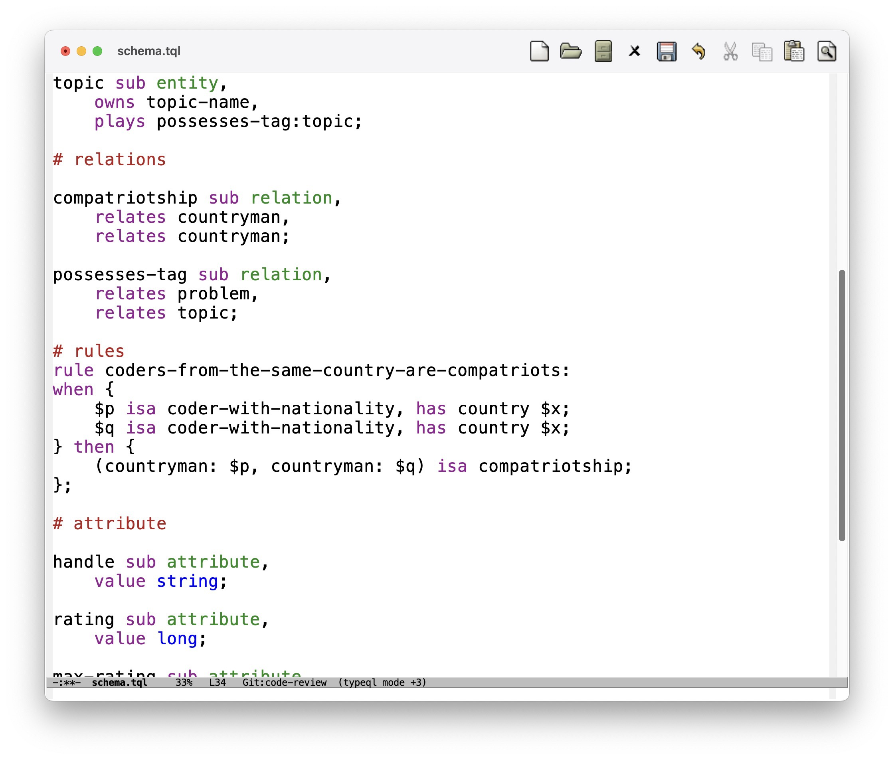

# TypeQL Plugin for Emacs

**Note** this plugin currently only handles 2.x syntax. Many elements are identical in 3.x, though some highlights will be inaccurate where the language has changed.

Major mode that provides syntax highlighting for TypeQL.

Requires `fish-mode` as well.

## Notes

- Using `derived-mode` for a simple implementation.
- Derives `fish-mode` since it most closely resembles the syntax structure.
